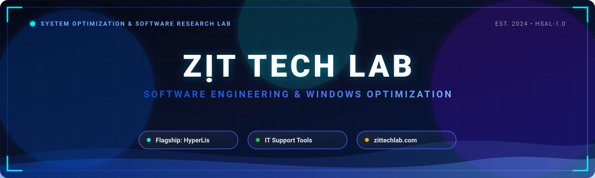

  <!-- Header Banner -->
  

    

  <!-- Dynamic Typing Animation -->
  

  <!-- Badges Ribbon -->
  

    
    
    
    
    
  

---

### 🦆 Giới thiệu về Zịt Tech Lab (About Us)

**Zịt Tech Lab (Zịt's Tech Lab)** là nhóm sinh viên nghiên cứu và phát triển phần mềm độc lập tại Việt Nam, hướng tới việc sáng tạo các công cụ quản trị hệ thống, tối ưu hóa hệ điều hành Windows và giải pháp hỗ trợ kỹ thuật IT Helpdesk chuyên sâu.

- 🎯 **Sứ mệnh**: Xây dựng các giải pháp tiện ích máy tính ổn định, hiệu năng cao, đồng thời chia sẻ kiến thức kỹ thuật phần mềm hệ thống và truyền cảm hứng cho cộng đồng lập trình viên, sinh viên đam mê công nghệ.
- ⚡ **Thế mạnh nghiên cứu**: Ứng dụng Desktop Windows native (.NET / C#), tự động hóa quản trị hệ điều hành với PowerShell, chẩn đoán & tinh chỉnh tài nguyên hệ thống.
- 📍 **Khu vực hoạt động**: Vinhomes Grand Park, TP. Hồ Chí Minh, Việt Nam.
- 🌐 **Cổng thông tin chính thức**: [zittechlab.com](https://zittechlab.com/)

---

### 🌟 Hệ sinh thái Dự án (Featured Ecosystem & Projects)

| ⚡ Dự án | 📋 Mô tả & Tính năng chính | 🏷️ Công nghệ & Trạng thái |
| :--- | :--- | :--- |
| **[HyperLis](https://github.com/ZitTechLab/HyperLis)** *A Software for IT Support* | Phần mềm cứu hộ, chẩn đoán sự cố, dọn dẹp và tối ưu hóa hệ thống Windows chuyên dụng dành cho kỹ thuật viên IT Helpdesk và người dùng nâng cao. |      |
| **[HyperLis Documentation](https://github.com/ZitTechLab/HyperLis_Documentation)** | Kho tài liệu kỹ thuật, kiến trúc module và cẩm nang hướng dẫn sử dụng chi tiết hệ sinh thái phần mềm HyperLis. |   |
| **[WSAP](https://github.com/ZitTechLab/WSAP)** *Windows Setup Automation Protocol* | Bộ công cụ cài đặt Windows tự động không cần dùng đến USB Boot. Được nghiên cứu và phát hành lần đầu tiên vào 14-03-2026. Thuật toán và tên gọi liên quan thuộc quyền sở hữu của © Zịt's Tech Lab |  |

---

### 🛠️ Ngăn xếp Công nghệ & Công cụ (Tech Stack & Tooling)

#### Ngôn ngữ & Nền tảng phát triển

  

#### Môi trường kỹ thuật & Quy trình làm việc

  

---

### 🐍 Hoạt động đóng góp (Contribution Activity)

<picture>
  <source media="(prefers-color-scheme: dark)" srcset="https://raw.githubusercontent.com/ZitTechLab/ZitTechLab/output/github-contribution-grid-snake-dark.svg" />
  <source media="(prefers-color-scheme: light)" srcset="https://raw.githubusercontent.com/ZitTechLab/ZitTechLab/output/github-contribution-grid-snake.svg" />
  
</picture>

---

### 📜 Chính sách Bản quyền & Đóng góp (Licensing & Collaboration)

Hệ sinh thái phần mềm tại **Zịt Tech Lab** (tiêu biểu là **HyperLis**) được phân phối dưới giấy phép nguồn mở có điều kiện: **HyperLis Source-Available License v1.0 (HSAL-1.0)**.

- ✅ **Được phép**: Tự do tải về, clone, đọc hiểu mã nguồn, biên dịch thử nghiệm nội bộ phục vụ học tập, nghiên cứu cá nhân và đóng góp sửa lỗi qua GitHub Pull Requests.
- 🚫 **Nghiêm cấm**: Khai thác thương mại, đóng gói mã nguồn vào các sản phẩm thương mại khác, hoặc tự ý đổi tên (rebrand) và tái phân phối khi chưa có sự cho phép bằng văn bản từ Zịt Tech Lab Development Team.

---

### 🌐 Kết nối & Tham gia cùng chúng tôi (Connect With Us)

&nbsp;

&nbsp;

 

📍 **Địa chỉ**: Vinhomes Grand Park, TP. Hồ Chí Minh, Việt Nam

---

  <!-- Footer Banner -->
  

    

  <i>"Empowering Systems, Optimizing Performance." — Zịt Tech Lab</i>

